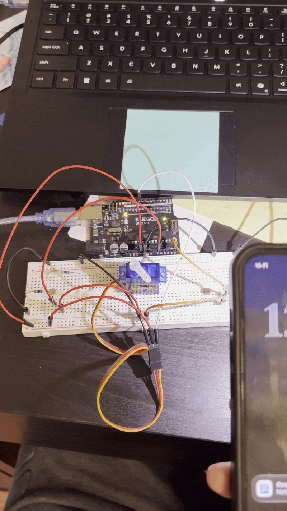

# servo-light-tracker

A quick and simple project, the goal is to get the servo to turn and follow a source of light using two photoresistors. Code is explained below

- I placed a photoresistor at each end of the breadboard with the a servo in the middle to detect the light.
- Next is to read the values of the two photoresistors and take the normalized difference so I could compare the two readings regardless of the light intensity. The equation is below:

$$Difference = \frac{(Left - Right)}{(Left + Right)}$$

- Then I map it into degrees using this equation:

$$ Degree = 180*(1-Difference)$$

- The reason why this works is because the normalized difference equation will give a value between -1 and 1, with the assumption that the sum of the readings are nonzero (or else divide by zero error). So we then subtract the normalized difference by 1 and multiply by 180 to get that percentage in degrees with a range of 0 to 360.
- The final step was to subtract 90 from the degree for the servo. I centered the servo on the side, so 90 degree on the servo is actually "straight" or in between the two photo resistors. The problem with my implementation was that now we would get a range of -90 to 270. But the servo library constrains the pulse lengths, so you can't exceed the range 0 to 180, which is why it still works. 
